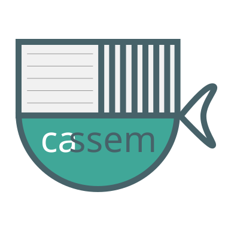
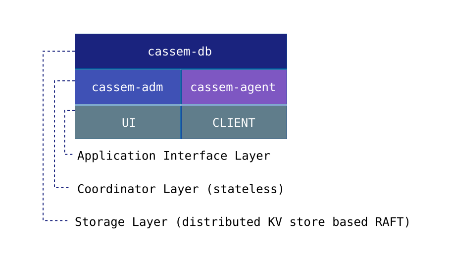
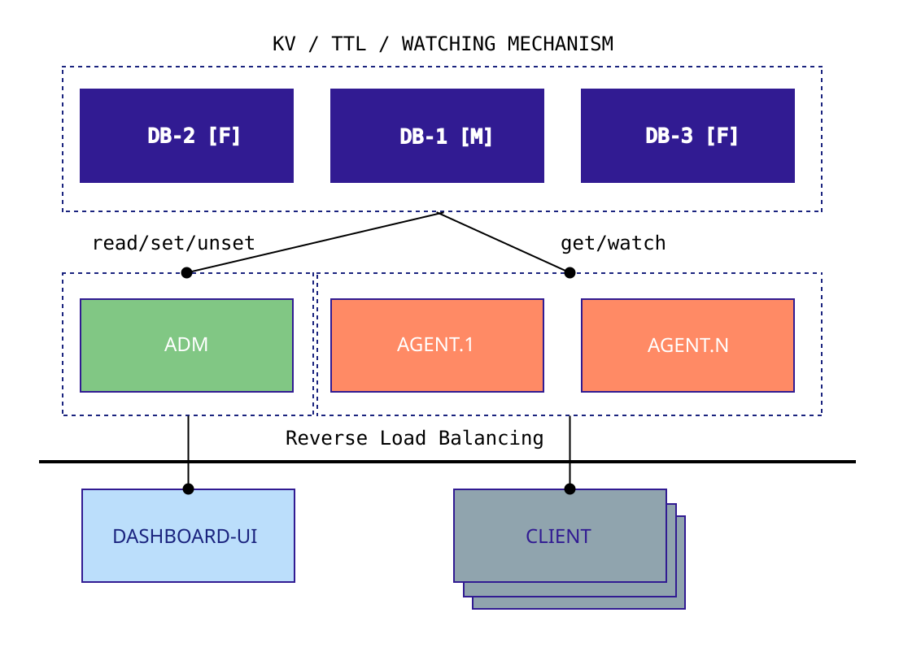
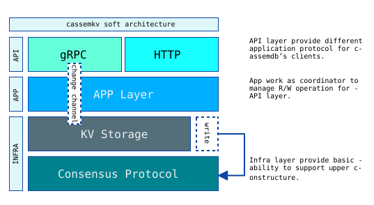

# cassem

<p align="center">
  
</p>

[](https://goreportcard.com/report/github.com/yeqown/cassem) [](https://pkg.go.dev/github.com/yeqown/cassem)

`CASSEM` is a distributed config management center, it is totally independent, so it's easy to deploy and maintain in your environment. At the
same time, it's deployed by `Go` which gives it platform-cross ability and fast-compile.


## Features

- [x] HTTP Restful API to manage all configs `cassemadm`.
  - [x] Stateless so that it can be easily scaled.
  - [x] Gray released.
  - [x] Multi-version management.
  - [ ] Operation log, each operation to config elements will be recorded.
  - [x] Permission control.
  - [x] Client instance management.
  - [ ] `CTL` / `UI` tool support these are constructing on `cassemadm` RESTful API.
    - [ ] [Web UI](https://github.com/yeqown/cassem-ui) is developing.
    - [ ] [CTL](#) tool to debug and manage config from terminal. 
  - [ ] OpenTelemetry metrics support
- [x] Distributed storage component `cassemkv`, based on raft consensus algorithm.
  - [x] Master can read and write.
  - [x] Slave node can only respond to read request.
  - [x] Use `gRPC` protocol to communicate.
  - [x] `Watch` `TTL` features support.
  - [ ] `Lazy Deletion` the expired KV. There is a deleting working thread to delete KV from queue, the queue's data is from
  - [ ] OpenTelemetry metrics support
  two part, one is `operation check`, another is `timer check`.
- [x] Stateless agent component `cassemagent` to improve client's usability.
  - [x] Cache config elements, and using `LRU-K` replacing algorithm.
  - [ ] Language independent support `HTTP` and `gRPC` protocol.
  - [x] Client SDK, easy to use.
  - [x] `Change Push` ability, gray released also built on this.
  - [ ] OpenTelemetry metrics support

- [ ] Fully test cases.
- [ ] One-liner deploy sh script.
- [x] Docker Compose deploy YAML script.
- [ ] GitHub CI Actions automate.

## [Documentation](./docs/README.md)



Explanation: 
- **_cassemkv_** provide KV storage capacity. 
- **_cassemadm_** is the manager to whole cassem application. 
- **_cassemagent_**‘s major duty is helping clients to access config easier,
   makes cassemkv work transparently to clients.  Importantly, cassemagent
   is stateless so that it could easily scale up and load balance.



### - [cassemkv](./cmd/cassemkv/README.md)

The KV storage component in cassem, provide gRPC API.



### - [cassemadm](cmd/cassemadm/README.md)

The manager in cassem, provide RESTful API to communicate. It is serving for CTL and Dashboard UI.

### - [cassemagent](cmd/cassemagent/README.md)

Agent is serving for user's client, agent SDK, actually. Of course, agent is stateless server.

## Client SDK

Application developers can start directly with the [Go SDK](./sdk/go/README.md), an independent module at `github.com/yeqown/cassem/sdk/go`. See [`sdk/`](./sdk/README.md) for the SDK overview.

The Go SDK connects to `cassemagent` for configuration reads, change subscriptions and client registration/renewal. Its guide documents installation from this checkout and runnable usage; the module path does not imply a release has been published.

## Repository Layout

```text
sdk/                     # Application-facing SDKs, currently Go
thirdparty/cassem/       # Canonical client/ and internal/ protobuf definitions
internal/protogen/       # All internal generated protobuf and gRPC bindings
internal/concept/        # Shared handwritten interfaces, adapters and key rules
internal/kvclient/       # Shared KV client, resolver and distributed locking
internal/pkg/            # Server configuration, transport and runtime helpers
internal/app/            # Service implementations
internal/coord/          # Internal coordination logic
cmd/                     # Server entrypoints
.deploy/example-configs/ # Example TOML configs and local Compose cluster
web/                     # Admin UI
```

The server belongs to the root Go module; only `sdk/go` is a separate Go module. Client protocol bindings are generated once into `sdk/go/protogen` and shared by the SDK and server. KV, Raft, ACL and delivery bindings share `internal/protogen`. See [protocol generation](./thirdparty/cassem/README.md) for source and generated-code ownership.

## Local Cluster

The local full-cluster workflow uses Compose from [`.deploy/example-configs/compose.cluster.yaml`](./.deploy/example-configs/compose.cluster.yaml). The Makefile exposes `build-image`, cluster lifecycle, and quality-check entrypoints. `build-image` writes Linux binaries to ignored `bin/` before building local images.

```bash
make cluster.start
make cluster.status
make cluster.logs
make cluster.stop
make cluster.clean
```

The cluster script uses Podman Compose by default. Use `CONTAINER_TOOL=docker make cluster.start` to run the same workflow with Docker Compose.

### Integration release gate

Run the full local release gate with a clean Compose cluster:

```bash
make test.integration.cluster
```

This target builds Web assets and Linux binaries, builds local images, starts the example Compose cluster, waits for cassemkv/cassemadm/cassemagent readiness, runs integration tests in strict mode, prints logs on failure, and removes containers/volumes afterward.

Docker users can override the default Podman runtime:

```bash
CONTAINER_TOOL=docker make test.integration.cluster
```

Use the same `IMAGE_TAG` when starting a cluster manually:

```bash
IMAGE_TAG=dev-gate make cluster.start
make cluster.clean
```

## Web UI Development

The embedded admin UI source lives in [`web`](./web). For local Web UI development, run the Vite dev server on its own `IP:PORT` and proxy `/api` requests to `cassemadm` instead of relying on embedded `/ui/` serving.

```bash
make ui.install
CASSEMADM_API_TARGET=http://127.0.0.1:20218 npm run dev --prefix web -- --port 4173
```

Then open `http://<your-ip>:4173/` for the standalone dev UI. If you started the local cluster with `make cluster.start`, the default admin API target is `http://127.0.0.1:20218`.

Production and local image builds still use embedded assets under `/ui/` through `make ui.build` and `make cluster.start`.

The Web UI supports English and Simplified Chinese. Use the language menu immediately to the left of the account icon; the login page also provides a language menu. The initial language follows the browser's preferences (falling back to English), and an explicit choice is saved in `localStorage` as `cassem.locale`. Switching languages preserves the current page and unsaved form contents.

Translations live in `web/src/i18n/catalogs/`, grouped by feature. Add matching English and Chinese entries with the same `{parameter}` names, and use the typed `useI18n().t` helper for interface text. Use its date and number formatters for locale-sensitive values. Configuration contents, identifiers, and diagnostic details returned by the server remain unchanged.

## Tests and Benchmark

- Unit tests: `make test`
- Go SDK tests with race detection: `make test.sdk`.
- Vet: `make vet`
- Lint: `make lint`
- Integration tests: `make test.integration.cluster`
- Local benchmarks: `go test -bench=. -benchmem ./tests/benchmark`
- Integration benchmarks: `go test -tags integration -bench=. -benchmem ./tests/benchmark`

Benchmarks live in [`tests/benchmark`](./tests/benchmark) and use Go benchmark code instead of shell scripts or external load-testing tools.

## References

* https://github.com/yongman/leto
* https://github.com/laohanlinux/riot
